# Execution Plan

## Detailed Analysis Summary

### Change Impact Assessment
- **User-facing changes**: Yes — 새로운 웹 애플리케이션 (검색, 약상자, 상성 분석 UI)
- **Structural changes**: Yes — 완전한 새 시스템 아키텍처 (Next.js + NestJS + PostgreSQL)
- **Data model changes**: Yes — 약물, 음식, 상호작용, 사용자, 약상자 테이블 설계 필요
- **API changes**: Yes — RESTful API 전체 설계 필요
- **NFR impact**: Yes — 복원력 요구사항, PBT 테스트 전략 적용

### Risk Assessment
- **Risk Level**: Medium
- **Rollback Complexity**: Easy (Greenfield, 기존 시스템 영향 없음)
- **Testing Complexity**: Moderate (PBT 적용, 다국어, 인증 통합)

---

## Workflow Visualization

```mermaid
flowchart TD
    Start(["User Request"])
    
    subgraph INCEPTION["INCEPTION PHASE"]
        WD["Workspace Detection<br/>COMPLETED"]
        RA["Requirements Analysis<br/>COMPLETED"]
        WP["Workflow Planning<br/>COMPLETED"]
        AD["Application Design<br/>EXECUTE"]
        UG["Units Generation<br/>EXECUTE"]
    end
    
    subgraph CONSTRUCTION["CONSTRUCTION PHASE"]
        FD["Functional Design<br/>EXECUTE"]
        NFRA["NFR Requirements<br/>EXECUTE"]
        NFRD["NFR Design<br/>EXECUTE"]
        ID["Infrastructure Design<br/>EXECUTE"]
        CG["Code Generation<br/>EXECUTE"]
        BT["Build and Test<br/>EXECUTE"]
    end
    
    Start --> WD
    WD --> RA
    RA --> WP
    WP --> AD
    AD --> UG
    UG --> FD
    FD --> NFRA
    NFRA --> NFRD
    NFRD --> ID
    ID --> CG
    CG --> BT
    BT --> End(["Complete"])

    style WD fill:#4CAF50,stroke:#1B5E20,stroke-width:3px,color:#fff
    style RA fill:#4CAF50,stroke:#1B5E20,stroke-width:3px,color:#fff
    style WP fill:#4CAF50,stroke:#1B5E20,stroke-width:3px,color:#fff
    style AD fill:#FFA726,stroke:#E65100,stroke-width:3px,stroke-dasharray: 5 5,color:#000
    style UG fill:#FFA726,stroke:#E65100,stroke-width:3px,stroke-dasharray: 5 5,color:#000
    style FD fill:#FFA726,stroke:#E65100,stroke-width:3px,stroke-dasharray: 5 5,color:#000
    style NFRA fill:#FFA726,stroke:#E65100,stroke-width:3px,stroke-dasharray: 5 5,color:#000
    style NFRD fill:#FFA726,stroke:#E65100,stroke-width:3px,stroke-dasharray: 5 5,color:#000
    style ID fill:#FFA726,stroke:#E65100,stroke-width:3px,stroke-dasharray: 5 5,color:#000
    style CG fill:#4CAF50,stroke:#1B5E20,stroke-width:3px,color:#fff
    style BT fill:#4CAF50,stroke:#1B5E20,stroke-width:3px,color:#fff
    style Start fill:#CE93D8,stroke:#6A1B9A,stroke-width:3px,color:#000
    style End fill:#CE93D8,stroke:#6A1B9A,stroke-width:3px,color:#000
    style INCEPTION fill:#BBDEFB,stroke:#1565C0,stroke-width:2px
    style CONSTRUCTION fill:#C8E6C9,stroke:#2E7D32,stroke-width:2px

    linkStyle default stroke:#333,stroke-width:2px
```

---

## Phases to Execute

### INCEPTION PHASE
- [x] Workspace Detection (COMPLETED)
- [x] Requirements Analysis (COMPLETED)
- [ ] ~~User Stories~~ (SKIPPED)
  - **Rationale**: 단일 사용자 유형(일반 개인), MVP 범위 명확, 추가 스토리 불필요
- [x] Workflow Planning (COMPLETED)
- [ ] Application Design - EXECUTE
  - **Rationale**: 새로운 컴포넌트/서비스 전체 설계 필요 (API, 서비스 레이어, 데이터 모델)
- [ ] Units Generation - EXECUTE
  - **Rationale**: 프론트엔드/백엔드/인프라 등 복수 유닛으로 분해 필요

### CONSTRUCTION PHASE (Per-Unit)
- [ ] Functional Design - EXECUTE
  - **Rationale**: 비즈니스 로직(상성 분석 엔진), 데이터 모델, API 계약 상세 설계 필요
- [ ] NFR Requirements - EXECUTE
  - **Rationale**: Resiliency 확장 활성화됨, 성능/가용성 요구사항 구체화 필요
- [ ] NFR Design - EXECUTE
  - **Rationale**: NFR Requirements 실행에 따른 패턴 반영 필요
- [ ] Infrastructure Design - EXECUTE
  - **Rationale**: AWS + Vercel 배포 아키텍처, DB, CI/CD 파이프라인 설계 필요
- [ ] Code Generation - EXECUTE (ALWAYS)
  - **Rationale**: 전체 코드 구현
- [ ] Build and Test - EXECUTE (ALWAYS)
  - **Rationale**: 빌드, 테스트, 검증 지침 생성

### OPERATIONS PHASE
- [ ] Operations - PLACEHOLDER

---

## Estimated Timeline
- **Total Stages to Execute**: 8 (Application Design, Units Generation, Functional Design, NFR Requirements, NFR Design, Infrastructure Design, Code Generation, Build and Test)
- **Estimated Interactions**: 10-15회 (승인 게이트 포함)

## Success Criteria
- **Primary Goal**: 약-음식 상호작용을 확인할 수 있는 웹 애플리케이션 MVP 완성
- **Key Deliverables**:
  - Next.js 프론트엔드 (검색, 약상자, 결과 표시)
  - NestJS 백엔드 API (인증, 검색, 분석)
  - PostgreSQL 데이터베이스 스키마 + 시드 데이터
  - Property-based 테스트 포함 테스트 스위트
  - GitHub Actions CI/CD 파이프라인
  - 인프라 코드 (배포 설정)
- **Quality Gates**:
  - 모든 PBT 테스트 통과
  - Resiliency 규칙 준수 확인
  - 한국어/영어 다국어 동작 확인
  - 인증 플로우 (이메일 + 소셜) 정상 동작
